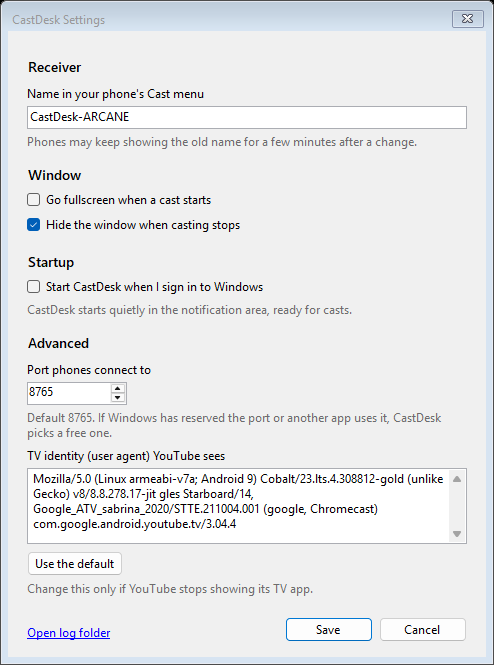

<p align="center">
  
</p>

<h1 align="center">CastDesk</h1>

<p align="center">
  Cast YouTube from your phone to your Windows PC.<br />
  Your phone's YouTube app finds the PC in its Cast menu, the same way it finds a smart TV, and the video plays on the
  PC in YouTube's own TV app.
</p>

---

## Contents

- [Why CastDesk](#why-castdesk)
- [Features](#features)
- [Requirements](#requirements)
- [Installing and running](#installing-and-running)
- [Using CastDesk](#using-castdesk)
  - [Casting from your phone](#casting-from-your-phone)
  - [Signing in](#signing-in)
  - [The player window](#the-player-window)
  - [Tray icon](#tray-icon)
  - [Volume mixer and media controls](#volume-mixer-and-media-controls)
- [Settings](#settings)
- [Settings file](#settings-file)
- [How it works](#how-it-works)
- [Troubleshooting](#troubleshooting)
- [Limitations](#limitations)
- [Building from source](#building-from-source)
- [Project structure](#project-structure)

## Why CastDesk

Windows can't receive a cast from the YouTube app. CastDesk adds that without a browser extension or stream ripping:
it runs YouTube's own TV app (youtube.com/tv) in a window, so playback, quality (up to 4K), captions, sign-in and
the phone connection are all YouTube's, as on a TV.

## Features

- **Shows up in the phone's Cast menu** as **CastDesk-*PC name*** (for example CastDesk-ARCANE), on every network
  adapter. The phone's controls work as with a TV: play, pause, seek, next, the queue, and picking another
  video.
- **Starts in the tray** and comes to the front when you cast; hides again a few seconds after you stop.
- **Nothing plays in the background:** hiding the window unloads the TV app.
- **Fullscreen** with F11, Alt+Enter or a button, and a **Back** button for the TV app.
- **Named "CastDesk" in Windows:** in the volume mixer and the media controls (with title, play/pause and next/previous),
  instead of "Microsoft Edge WebView2" and "Unknown app". Media keys work.
- **Signed in once:** your YouTube sign-in is kept in CastDesk's own browser profile.
- **Settings window** for the name, window behaviour, starting with Windows, the port and the TV identity.

## Requirements

- Windows 10 version 2004 or later, or Windows 11 (x64)
- [.NET 10 Desktop Runtime](https://dotnet.microsoft.com/download/dotnet/10.0) (x64)
- Microsoft Edge WebView2 Runtime (included with Windows 11; CastDesk tells you if it's missing)
- The phone and the PC on the same network
- The YouTube app on the phone

## Installing and running

There's no installer yet. Build CastDesk (see [Building from source](#building-from-source)), or publish a folder you
can copy elsewhere:

```powershell
dotnet publish -c Release -o publish
```

Run `CastDesk.exe`. It starts in the notification area (tray); only one copy runs at a time. To start it with Windows,
turn on **Start CastDesk when I sign in to Windows** in [Settings](#settings).

### Allow CastDesk through Windows Firewall

Phones reach CastDesk on TCP port 8765 (DIAL) and UDP port 1900 (SSDP discovery). The first time CastDesk starts,
Windows asks whether to allow it: allow it. To add the rule yourself, from an administrator PowerShell:

```powershell
New-NetFirewallRule -DisplayName "CastDesk" -Direction Inbound -Program "<path to>\CastDesk.exe" -Action Allow -Profile Private,Public
```

If Windows has reserved port 8765 (Hyper-V and WSL reserve port ranges, which can move after a reboot), CastDesk uses
a free port instead; phones find it either way.

## Using CastDesk

### Casting from your phone

In the YouTube app on your phone, tap **Cast** and choose **CastDesk-*your PC's name***. The player window comes to the
front and YouTube's TV app opens the video. Control it from the phone as you would a TV. When the phone stops casting,
the window hides to the tray after 3 seconds (you can turn that off).

Another way to connect, without the Cast menu: in the TV app open **Settings → Link with TV code**, and on the phone
go to **YouTube settings → Watch on TV → Enter TV code**. The phone then lists the PC under the name YouTube gives it.

### Signing in

Signing in is optional but gives you your recommendations, subscriptions and Premium. Click **Show Player** in the
tray menu, choose sign-in in the TV app, and enter the code it shows at yt.be/activate on your phone. The sign-in is
kept in CastDesk's own browser profile (`%LOCALAPPDATA%\CastDesk\WebView2`), separate from Edge.

### The player window

You can also use the TV app on the PC directly: **Show Player**, then the keyboard or mouse.

| Key or action | Effect |
|---|---|
| F11, Alt+Enter, or the button in the top-right corner | Fullscreen on/off (the button appears when you move the mouse) |
| Esc, or the arrow button in the top-left corner | The TV app's Back (the button appears when you move the mouse, except on the home screen) |
| Arrow keys, Enter | Move around the TV app and pick |
| Window close button | Hide to the tray. The TV app is unloaded, so nothing plays in the background; a cast or **Show Player** opens it again. Hiding during a cast ends that cast. |
| Minimize | Keeps playing |

### Tray icon

Left-click shows the player. Right-click opens the menu:

| Item | What it does |
|---|---|
| Status | The receiver status, for example "Ready. Cast to "CastDesk-ARCANE" from the YouTube app." |
| **Show Player** | Shows the window and the TV app's home screen |
| Reload YouTube | Reloads the TV app (for playback problems) |
| Restart Receiver | Restarts discovery; phones may need to reopen their Cast menu |
| Settings… | Opens [Settings](#settings) |
| Exit | Quits CastDesk; phones drop it from their Cast menu |

### Volume mixer and media controls

CastDesk shows up as **CastDesk** in Windows' volume mixer and in the media controls (Quick Settings and the volume
flyout), with the video's title, play/pause and next/previous. The keyboard's media keys work too. Apps that name sound
by program file instead, such as SteelSeries Sonar, still show "Microsoft Edge WebView2".

## Settings

Open **Settings…** from the tray menu. Changes take effect when you click **Save**; there's no need to restart
CastDesk.



| Setting | Default | What it does |
|---|---|---|
| Name in your phone's Cast menu | CastDesk-*PC name* | What phones list. They may show the old name for a few minutes after a change. |
| Go fullscreen when a cast starts | Off | Switches the window to fullscreen whenever a phone casts. |
| Hide the window when casting stops | On | Hides the window to the tray 3 seconds after the phone stops casting. |
| Start CastDesk when I sign in to Windows | Off | Adds CastDesk to your startup apps, starting quietly in the tray. |
| Port phones connect to | 8765 | If Windows has reserved it or another app uses it, CastDesk picks a free one. |
| TV identity (user agent) YouTube sees | A Chromecast with Google TV | Change it only if YouTube stops showing its TV app; **Use the default** puts it back. |

**Open log folder** opens `%LOCALAPPDATA%\CastDesk`, which holds the log.

## Settings file

Everything CastDesk keeps is in `%LOCALAPPDATA%\CastDesk`:

| File | What it holds |
|---|---|
| `settings.json` | The settings above: `FriendlyName`, `FullscreenOnCast`, `HideWhenCastingStops`, `DialPort`, `UserAgent` (empty means the default). Missing fields keep their defaults. |
| `device-id.txt` | The ID phones remember CastDesk by. Keep it, or phones will list CastDesk twice for a while. |
| `WebView2\` | The TV app's browser profile, with your YouTube sign-in. Deleting it signs you out. |
| `castdesk.log` | The log. A new one starts at 1 MB, keeping the previous one as `castdesk.log.old`. |

In the registry (current user only): the startup entry `CastDesk` under
`HKCU\Software\Microsoft\Windows\CurrentVersion\Run` while **Start CastDesk when I sign in** is on, and CastDesk's name
and icon for the media controls under `HKCU\Software\Classes\AppUserModelId\CastDesk.Receiver`.

## How it works

1. **Discovery (SSDP).** CastDesk answers the phone's "any TVs here?" multicast searches on UDP 1900 and announces
   itself every few minutes, on every network adapter. The answer points at a device description on port 8765.
2. **Launch (DIAL).** When you pick CastDesk, the phone sends `POST /apps/YouTube` with a pairing code and the video
   to play. CastDesk opens `youtube.com/tv` with that launch data in its window.
3. **Pairing.** YouTube's TV app uses the pairing code to join the phone's casting session through YouTube's servers,
   and reports its screen details to an `additionalDataUrl`. CastDesk answers that request inside WebView2 and serves
   the details at `GET /apps/YouTube`, where the phone reads them. From then on the phone and the TV app talk through
   YouTube directly, as with a real TV.
4. **The TV identity.** youtube.com/tv only serves its TV app to TV browsers, so CastDesk's WebView2 presents a
   Chromecast with Google TV's user agent. That's why linked-TV lists may show it as a Google device.
5. **Windows labels.** The TV app's sound is played by WebView2's own processes, so Windows would call it "Microsoft
   Edge WebView2" in the volume mixer and "Unknown app" in the media controls. CastDesk renames its WebView2 audio
   sessions to "CastDesk" (Core Audio API), turns WebView2's media controls off, and registers its own on its window,
   fed by a small script in the TV app. So that Windows can name those controls, CastDesk uses the app ID
   `CastDesk.Receiver` and registers its name and icon for it (no Start-menu entry).

## Troubleshooting

- **Log file:** `%LOCALAPPDATA%\CastDesk\castdesk.log`. Lines marked `[dial]` show each request from a phone.
- **CastDesk isn't in the Cast menu:** check that the phone and PC are on the same network and that Windows Firewall
  allows CastDesk.exe, then use **Restart Receiver**.
- **CastDesk appears twice:** the phone still remembers an older entry. It disappears within about 30 minutes, or
  sooner if you turn the phone's Wi-Fi off and on.
- **YouTube says this browser isn't supported, or the TV app looks wrong:** YouTube may have stopped accepting the TV
  identity. Enter a different one under **Settings… → Advanced**.
- **Playback problems:** use **Reload YouTube** in the tray menu.

## Limitations

- **YouTube only.** Netflix casts only to devices Netflix has certified, and Spotify's PC app already shows up in the
  phone's Spotify device list by itself.
- **No screen mirroring.** Windows' Miracast receiver API can't be used from a desktop app, and iPhone (AirPlay) and
  Pixel (Google Cast) mirroring would need their protocols reverse-engineered.
- **Google Cast apps other than YouTube** don't see CastDesk: it's a DIAL receiver, not a Chromecast.

## Building from source

Needs the [.NET 10 SDK](https://dotnet.microsoft.com/download/dotnet/10.0).

```powershell
dotnet build -c Debug       # bin\Debug\net10.0-windows10.0.19041.0\win-x64\CastDesk.exe
dotnet build -c Release     # bin\Release\net10.0-windows10.0.19041.0\win-x64\CastDesk.exe
dotnet run                  # build and start (in the tray)
```

A running CastDesk locks its exe: use **Exit** in the tray menu before building. The README screenshots are made by
`tools/readme-shots` (see [tools/README.md](tools/README.md)).

## Project structure

```
CastDesk.csproj
Program.cs             Entry point: single instance, WebView2 check, app ID
MainForm.cs            Player window, tray icon, fullscreen, show/hide on cast
CastDeskController.cs  Runs discovery and passes launch/stop requests to the window
Dial/
  SsdpAdvertiser.cs    SSDP: answers phones' searches and announces CastDesk
  DialHttpServer.cs    DIAL: device description, the YouTube app (launch, status, stop)
  HttpMessages.cs      Minimal HTTP request reading and response writing
Tv/
  TvAppView.cs         YouTube's TV app in WebView2, with the TV identity
  page-bridge.js       Injected into the TV app: media state, fullscreen keys, Back and Fullscreen buttons
  MediaState.cs        What the TV app is playing
Media/
  WindowsMediaControls.cs  CastDesk's entry in Windows' media controls
Configuration/
  CastDeskOptions.cs   settings.json loading and defaults
  DeviceIdentity.cs    The device ID phones remember
  StartupRegistration.cs  "Start CastDesk when I sign in"
Diagnostics/
  AppLog.cs            Writes %LOCALAPPDATA%\CastDesk\castdesk.log
UI/
  SettingsForm.cs      The Settings window
Interop/
  WindowTheme.cs       Dark title bar
  AudioSessionRenamer.cs  Names the TV app's sound "CastDesk" in the volume mixer
  ProcessTree.cs       Finds WebView2's child processes
  AppIdentity.cs       The app ID and registered name Windows' media controls use
Assets/
  CastDesk.ico         Tray, window and Explorer icon
  logo-64.png          README logo (made by tools/readme-shots)
docs/screenshots/      README screenshots
tools/                 Helper scripts (README screenshots); see tools/README.md
CLAUDE.md              Notes for working on CastDesk with Claude Code
```
